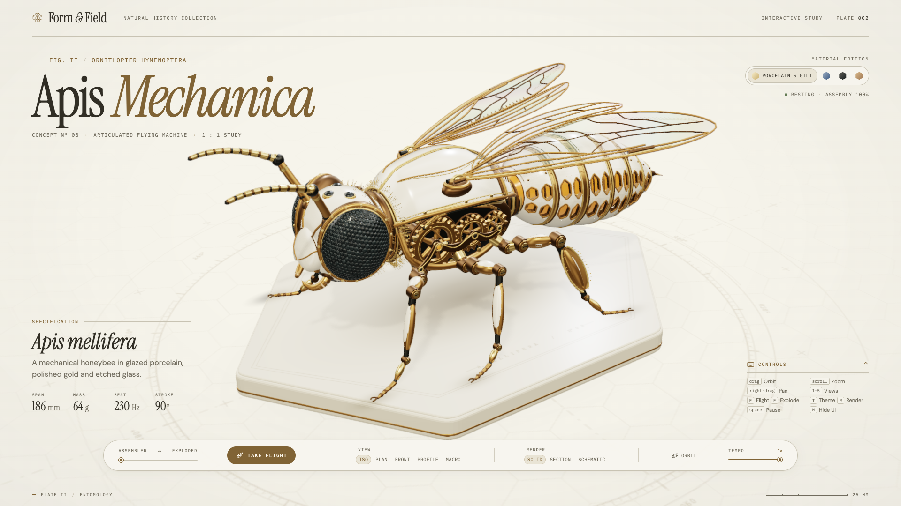

# Apis Mechanica

[Open the GPT-6.2 Astra exhibit](https://longhuynh-vn.github.io/apis-mechanica/GPT-6.2%20Astra/)



A real-time Three.js exhibition of a porcelain, gilt and etched-glass honeybee. The airframe, optics, gear teeth, spring linkages, glass membranes and drafting plate are generated locally. The fonts are bundled with the exhibit.

## Run the exhibit

```sh
npm install
npm run dev
```

Open the local address printed by Vite in a browser with WebGL 2. To serve the optimized production build, run `npm run build` followed by `npm run preview`.

`npm test` checks leg clearance during takeoff, landing and disassembly, touchdown timing and steering at 30, 60 and 120 fps.

## Operating the plate

Drag to orbit, scroll to zoom and right-drag to pan. Touch supports one-finger orbit and two-finger pan and zoom. Hover to read a specification. Select a component to frame it, then click the backdrop or press Escape to return.

| Key | Action |
| --- | --- |
| F | Take flight or land |
| E | Assemble or explode |
| T | Change material edition |
| R | Cycle solid, section and schematic rendering |
| 1–5 | Select ISO, plan, front, profile or macro |
| Space | Pause or resume the mechanism |
| H | Hide or restore the interface for recording |

At full tempo, each wing pair sweeps through a sampled exposure envelope. At the slowest setting, a nominal 230 Hz beat takes just over two seconds. The tongue can be extended from the proboscis specification.

## Construction

- `src/model/` contains the anatomical builders, rigid mounts, assembly axes and exploded-view guides.
- `src/flight.js` integrates steering, body attitude, resonant motion, bilateral wing kinematics and the damped appendages. The 24-tooth wheel advances one tooth per beat. The 16- and 12-tooth wheels follow the same pitch module and alternate direction.
- `src/materials.js` defines the four editions, physical surfaces, Delft painting and studio environment.
- `src/stage.js`, `src/optics.js` and `src/post.js` handle the plate, camera, depth of field, antialiasing and depth-tested emissive bloom.
- `src/catalogue.js`, `src/labels.js` and `src/ui.js` provide the component records, projected label layout, telemetry and controls.

The 186 mm span and 64 g mass describe the mechanical specimen. Its nominal 90° hover stroke and 230 Hz wingbeat follow measurements of living honeybees. [Altshuler et al., PNAS](https://pmc.ncbi.nlm.nih.gov/articles/PMC1312389/)

The forewing’s marginal and three submarginal cells follow worker wing morphology. The hind-tibial baskets, branched hairs and three body regions are anatomical references for the corresponding mechanisms. [Wing venation in Apis mellifera](https://iris.unito.it/retrieve/handle/2318/1507231/74254/Redia_97_2014_20%20Wing%20venation%20teratology%20in%20A.%20mellifera.pdf) · [University of Florida honeybee account](https://ask.ifas.ufl.edu/publication/IN1005)

Instrument Serif, IBM Plex Mono and DM Sans are distributed with their SIL Open Font Licenses in `public/fonts/`.
